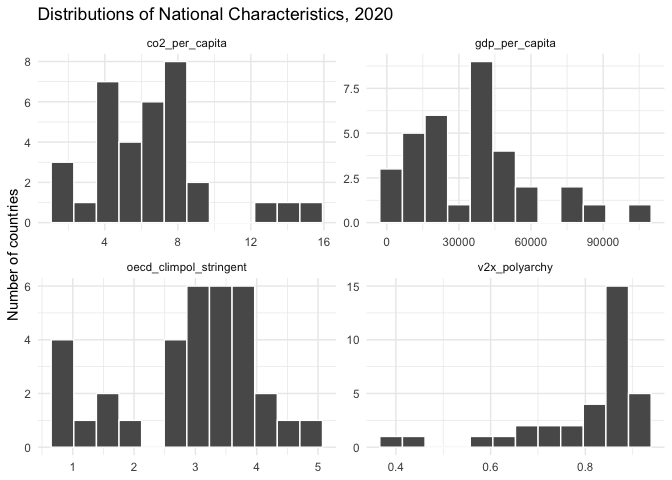
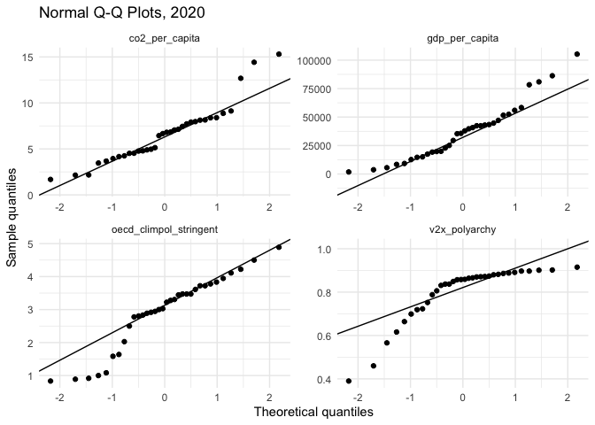
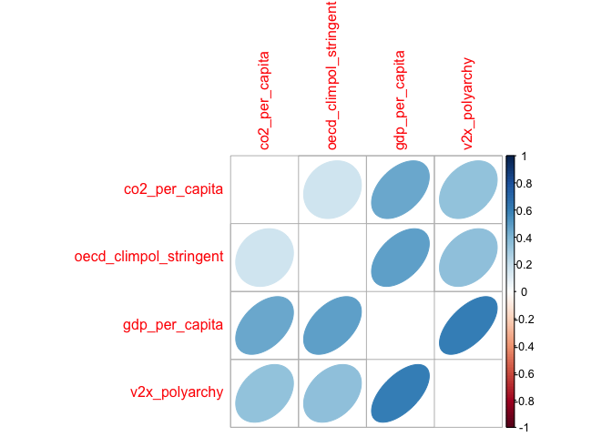
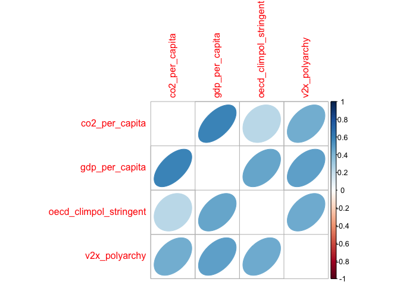

# Lab 5: Correlation, National Climate Policy, and Country Characteristics
Your Name
2026-11-13

- [<span class="toc-section-number">1</span>
  Introduction](#introduction)
  - [<span class="toc-section-number">1.1</span> Learning
    objectives](#learning-objectives)
- [<span class="toc-section-number">2</span> 1. Load packages and
  inspect the data](#1-load-packages-and-inspect-the-data)
  - [<span class="toc-section-number">2.1</span> Variables in the
    dataset](#variables-in-the-dataset)
- [<span class="toc-section-number">3</span> 2. Explore the
  distributions of the
  variables](#2-explore-the-distributions-of-the-variables)
- [<span class="toc-section-number">4</span> 3. Calculate correlations
  for 2020](#3-calculate-correlations-for-2020)
- [<span class="toc-section-number">5</span> 4. Compare correlations
  between 2000 and 2020](#4-compare-correlations-between-2000-and-2020)
- [<span class="toc-section-number">6</span> 5. Examine changes within
  countries](#5-examine-changes-within-countries)
- [<span class="toc-section-number">7</span> Challenge!](#challenge)
  - [<span class="toc-section-number">7.1</span> Final submission
    stuff](#final-submission-stuff)

## Introduction

How are national climate policies related to countries’ political
institutions, economic development, and carbon emissions? Do these
relationships look different in 2000 and 2020?

In this lab, you will use data from the OECD, the World Development
Indicators (WDI), and the Varieties of Democracy (V-Dem) project to
investigate these questions. You will use descriptive statistics,
visualizations, correlation coefficients, and statistical tests to
explore patterns across 34 countries.

Correlation can help identify relationships between variables, but it
cannot establish that one variable causes another. For example, an
association between democracy and climate-policy stringency does not
demonstrate that democratic institutions cause stronger climate
policies.

### Learning objectives

This lab assesses the following learning standards:

10. Derive new variables from existing ones through calculated
    transformations, including unit conversions, differences across time
    periods, and categorical dummy variables.
11. Assess the normality of a variable and use those results to select
    between parametric and non-parametric statistical tests.
12. Conduct correlation analysis across multiple variable pairs and
    evaluate results with respect to direction, magnitude, and
    significance, including changes in correlation structure across time
    periods or subgroups.

## 1. Load packages and inspect the data

We will use `tidyverse` for data manipulation and visualization, `Hmisc`
to calculate correlation matrices, and `corrplot` to visualize those
matrices.

``` r
library(tidyverse)
```

    ── Attaching core tidyverse packages ──────────────────────── tidyverse 2.0.0 ──
    ✔ dplyr     1.2.1     ✔ readr     2.2.0
    ✔ forcats   1.0.1     ✔ stringr   1.6.0
    ✔ ggplot2   4.0.3     ✔ tibble    3.3.1
    ✔ lubridate 1.9.5     ✔ tidyr     1.3.2
    ✔ purrr     1.2.2     
    ── Conflicts ────────────────────────────────────────── tidyverse_conflicts() ──
    ✖ dplyr::filter() masks stats::filter()
    ✖ dplyr::lag()    masks stats::lag()
    ℹ Use the conflicted package (<http://conflicted.r-lib.org/>) to force all conflicts to become errors

``` r
library(Hmisc)
```

    Attaching package: 'Hmisc'

    The following objects are masked from 'package:dplyr':

        src, summarize

    The following objects are masked from 'package:base':

        format.pval, units

``` r
library(corrplot)
```

    corrplot 0.95 loaded

``` r
library(knitr)

all_vars<-read_csv("data/climpolicy_combined.csv")
```

    Rows: 68 Columns: 8
    ── Column specification ────────────────────────────────────────────────────────
    Delimiter: ","
    chr (2): country_text_id, country_name
    dbl (6): year, oecd_climpol_stringent, co2_emissions, gdp, tot_population, v...

    ℹ Use `spec()` to retrieve the full column specification for this data.
    ℹ Specify the column types or set `show_col_types = FALSE` to quiet this message.

The combined dataset, `all_vars`, contains observations for 34 countries
in 2000 and 2020. Each row represents a country in a particular year.

### Variables in the dataset

| Variable | Description |
|:---|:---|
| `country_name` | Country name |
| `country_text_id` | Country identifier |
| `year` | Observation year |
| `oecd_climpol_stringent` | OECD-derived climate-policy stringency measure |
| `co2_emissions` | Total CO₂ emissions measure |
| `gdp` | Gross domestic product (constant 2015 US dollars) |
| `tot_population` | Total population |
| `v2x_polyarchy` | V-Dem electoral democracy index |

We will also calculate GDP per capita and CO₂ emissions per capita.

``` r
all_vars <- all_vars %>%
  mutate(
    gdp_per_capita = gdp / tot_population,
    co2_per_capita = co2_emissions * 1e6 / tot_population
  )
```

This calculation assumes `co2_emissions` is in million tonnes and
population is measured in persons. The resulting `co2_per_capita`
measure is tonnes per person. GDP per capita is in 2015 US dollars,
divided by population.

Inspect the new variables.

``` r
all_vars %>%
  select(
    country_name, year, oecd_climpol_stringent,
    co2_per_capita, gdp_per_capita, v2x_polyarchy
  ) %>%
  slice_head(n = 10) %>%
  kable(digits = 2)
```

| country_name | year | oecd_climpol_stringent | co2_per_capita | gdp_per_capita | v2x_polyarchy |
|:---|---:|---:|---:|---:|---:|
| Iceland | 2000 | 0.00 | 10.14 | 43472.34 | 0.87 |
| Iceland | 2020 | 1.00 | 8.38 | 52464.31 | 0.86 |
| Ireland | 2020 | 3.00 | 6.80 | 80927.94 | 0.89 |
| Denmark | 2000 | 2.00 | 9.95 | 49266.99 | 0.91 |
| Australia | 2000 | 0.83 | 18.60 | 45979.08 | 0.89 |
| Australia | 2020 | 2.92 | 15.30 | 58377.77 | 0.84 |
| Austria | 2000 | 1.89 | 8.32 | 38571.09 | 0.86 |
| Austria | 2020 | 3.31 | 7.06 | 43428.70 | 0.86 |
| Belgium | 2000 | 1.56 | 12.18 | 35878.32 | 0.88 |
| Belgium | 2020 | 3.44 | 7.97 | 40769.02 | 0.90 |

**Task 1** *Why might GDP per capita and CO₂ emissions per capita be
more useful than total GDP and total emissions when comparing
countries?*

{Your response here.}

## 2. Explore the distributions of the variables

Before calculating correlations, examine the distributions of the
variables. Correlation coefficients summarize relationships between
variables, and their interpretation can be affected by skewed
distributions and unusual observations.

We will focus on four measures:

- Climate-policy stringency
- CO₂ emissions per capita
- GDP per capita
- Electoral democracy

Create a subset for 2020.

``` r
data_2020 <- all_vars %>%
  filter(year == 2020)
```

We can then create histograms to examine the distributions for each of
the four variables of interest.

``` r
data_2020 %>%
  select(
    oecd_climpol_stringent,
    co2_per_capita,
    gdp_per_capita,
    v2x_polyarchy
  ) %>%
  pivot_longer(
    everything(),
    names_to = "variable",
    values_to = "value"
  ) %>%
  ggplot(aes(x = value)) +
  geom_histogram(bins = 12, color = "white") +
  facet_wrap(~ variable, scales = "free") +
  theme_minimal() +
  labs(
    title = "Distributions of National Characteristics, 2020",
    x = NULL,
    y = "Number of countries"
  )
```



The facets use different horizontal scales because the variables have
different units.

You can also examine normal Q-Q plots.

``` r
data_2020 %>%
  select(
    oecd_climpol_stringent,
    co2_per_capita,
    gdp_per_capita,
    v2x_polyarchy
  ) %>%
  pivot_longer(
    everything(),
    names_to = "variable",
    values_to = "value"
  ) %>%
  ggplot(aes(sample = value)) +
  stat_qq() +
  stat_qq_line() +
  facet_wrap(~ variable, scales = "free") +
  theme_minimal() +
  labs(
    title = "Normal Q-Q Plots, 2020",
    x = "Theoretical quantiles",
    y = "Sample quantiles"
  )
```



**Task 2** *Which variables appear most skewed? Pick one of these and
identify some of the countries that are outliers for this variable.*

v2x_polyarchy (Democracy index) appears very left skewed in the
histogram and Q-Q plot. This means that most countries have a higher
index, but there are a few that are very low. These are India, Hungary,
Indonesia, Poland and Mexico.

## 3. Calculate correlations for 2020

Correlation coefficients measure the direction and strength of
relationships between two numerical variables. Pearson’s correlation
coefficient is typically used when variables are approximately normally
distributed and exhibit a linear relationship, whereas Spearman’s rank
correlation coefficient is appropriate for non-normal or ordinal data.

**Task 3** *Select just the four variables of interest and create a
correlation matrix using the appropriate measure of correlation. Print
this table once you’ve created it.*

``` r
filter <- data_2020 %>%
    select(c(
    oecd_climpol_stringent,
    co2_per_capita,
    gdp_per_capita,
    v2x_polyarchy))

rcorr(as.matrix(filter))
```

                           oecd_climpol_stringent co2_per_capita gdp_per_capita
    oecd_climpol_stringent                   1.00           0.16           0.48
    co2_per_capita                           0.16           1.00           0.45
    gdp_per_capita                           0.48           0.45           1.00
    v2x_polyarchy                            0.36           0.35           0.61
                           v2x_polyarchy
    oecd_climpol_stringent          0.36
    co2_per_capita                  0.35
    gdp_per_capita                  0.61
    v2x_polyarchy                   1.00

    n= 34 


    P
                           oecd_climpol_stringent co2_per_capita gdp_per_capita
    oecd_climpol_stringent                        0.3634         0.0038        
    co2_per_capita         0.3634                                0.0074        
    gdp_per_capita         0.0038                 0.0074                       
    v2x_polyarchy          0.0388                 0.0436         0.0001        
                           v2x_polyarchy
    oecd_climpol_stringent 0.0388       
    co2_per_capita         0.0436       
    gdp_per_capita         0.0001       
    v2x_polyarchy                       

**Task 4** *Create a correlation plot from this matrix using `corrplot`
and the parameters of your choosing*

``` r
correlation_matrix <- cor(filter)
corrplot(correlation_matrix,order="hclust", method="ellipse",diag=FALSE)
```



**Task 5** Based on your correlation matrix and correlation plot, is
climate-policy stringency associated with electoral democracy, GDP per
capita, or CO₂ emissions per capita? Describe the direction and strength
of each relationship. Do the results support your expectations?

Stringency is positively correlated with GDP, CO2 emissions, and
democracy. It is moderately correlated (0.48) correlated with GDP. It is
slightly correlated (0.16) with CO2 emissions. It is slightly correlated
(0.36) with democracy. The strongest correlation with stringency is with
GDP, indicating richer countries have stricter policy. The result I
think is interesting is the positive correlation with C02; I would
expect stricter policy to result in lower emissions. A possible cause of
this could be that strict countries are the most developed (like the US)
and even though they have a strict policy they still emit a lot. I don’t
know, though.

## 4. Compare correlations between 2000 and 2020

Next, examine whether relationships between climate policy and national
characteristics differ across the two years. First, we can create a new
dataset for the observations in 2000.

``` r
data_2000 <- all_vars %>%
  filter(year == 2000)
```

**Task 6** *Create a new correlation matrix for 2000 and print it, just
as you did for the 2020 data. Then print both matrices so they can be
compared side-by-side.*

``` r
filter2000 <- data_2000 %>%
    select(c(
    oecd_climpol_stringent,
    co2_per_capita,
    gdp_per_capita,
    v2x_polyarchy))

rcorr(as.matrix(filter2000))
```

                           oecd_climpol_stringent co2_per_capita gdp_per_capita
    oecd_climpol_stringent                   1.00           0.23           0.47
    co2_per_capita                           0.23           1.00           0.58
    gdp_per_capita                           0.47           0.58           1.00
    v2x_polyarchy                            0.44           0.44           0.48
                           v2x_polyarchy
    oecd_climpol_stringent          0.44
    co2_per_capita                  0.44
    gdp_per_capita                  0.48
    v2x_polyarchy                   1.00

    n= 34 


    P
                           oecd_climpol_stringent co2_per_capita gdp_per_capita
    oecd_climpol_stringent                        0.1891         0.0051        
    co2_per_capita         0.1891                                0.0003        
    gdp_per_capita         0.0051                 0.0003                       
    v2x_polyarchy          0.0087                 0.0096         0.0038        
                           v2x_polyarchy
    oecd_climpol_stringent 0.0087       
    co2_per_capita         0.0096       
    gdp_per_capita         0.0038       
    v2x_polyarchy                       

``` r
correlation_matrix2000 <- cor(as.matrix(filter2000))
corrplot(correlation_matrix2000,order="hclust", method="ellipse",diag=FALSE)
```



``` r
correlation_matrix
```

                           oecd_climpol_stringent co2_per_capita gdp_per_capita
    oecd_climpol_stringent              1.0000000      0.1608767      0.4830545
    co2_per_capita                      0.1608767      1.0000000      0.4510920
    gdp_per_capita                      0.4830545      0.4510920      1.0000000
    v2x_polyarchy                       0.3559742      0.3481292      0.6077938
                           v2x_polyarchy
    oecd_climpol_stringent     0.3559742
    co2_per_capita             0.3481292
    gdp_per_capita             0.6077938
    v2x_polyarchy              1.0000000

``` r
correlation_matrix2000 
```

                           oecd_climpol_stringent co2_per_capita gdp_per_capita
    oecd_climpol_stringent              1.0000000      0.2307803      0.4694072
    co2_per_capita                      0.2307803      1.0000000      0.5833185
    gdp_per_capita                      0.4694072      0.5833185      1.0000000
    v2x_polyarchy                       0.4431007      0.4377211      0.4836060
                           v2x_polyarchy
    oecd_climpol_stringent     0.4431007
    co2_per_capita             0.4377211
    gdp_per_capita             0.4836060
    v2x_polyarchy              1.0000000

``` r
change = correlation_matrix - correlation_matrix2000
change
```

                           oecd_climpol_stringent co2_per_capita gdp_per_capita
    oecd_climpol_stringent             0.00000000    -0.06990358     0.01364732
    co2_per_capita                    -0.06990358     0.00000000    -0.13222652
    gdp_per_capita                     0.01364732    -0.13222652     0.00000000
    v2x_polyarchy                     -0.08712652    -0.08959190     0.12418780
                           v2x_polyarchy
    oecd_climpol_stringent   -0.08712652
    co2_per_capita           -0.08959190
    gdp_per_capita            0.12418780
    v2x_polyarchy             0.00000000

**Task 7** How did the correlation between climate-policy stringency and
electoral democracy change between 2000 and 2020? What about the
relationship between policy stringency and CO₂ emissions per capita?

Both democracy and CO2 emissions decreased in correlation between 2000
and 2020. This is interesting! Stricter countries are slightly less
democratic, but have gotten better at decreasing CO2 emissions in line
with policy. Good job!

## 5. Examine changes within countries

Remember that these matrices describe relationships across countries
within each year. A change in a correlation across years is not the same
as a change experienced by an individual country. To examine changes
over time, we can reshape the dataset so that each country’s 2000 and
2020 observations appear in the same row.

``` r
country_changes <- all_vars %>%
  select(
    country_text_id,
    country_name,
    year,
    oecd_climpol_stringent,
    co2_per_capita,
    gdp_per_capita,
    v2x_polyarchy
  ) %>%
  pivot_wider(
    names_from = year,
    values_from = c(
      oecd_climpol_stringent,
      co2_per_capita,
      gdp_per_capita,
      v2x_polyarchy
    ),
    names_sep = "_"
  ) 
```

**Task 8** *Calculate the change in each variable between 2000 and 2020
for every country.*

**Task 9** *To assess these changes, create a correlation matrix for
these four new variables. This will show *correlation in changes* across
countries.*

**Task 10** Identify the five countries with the largest increases and
the five countries with the largest decreases in climate-policy
stringency. Repeat this analysis for CO₂ emissions per capita.

{Your response here}

**Task 11** How does this within-country change analysis differ from
correlating climate-policy stringency and emissions across countries in
2020? Why might the two analyses produce different results?

{Your response here}

## Challenge!

Let’s map those variables showing change. The code below downloads
country boundaries from Natural Earth
(https://www.naturalearthdata.com/). Join your final dataset to these
boundaries and use `tmap` to create maps of each of the four variables
showing change from 2000-2020. What patterns do you see? How does it add
to/change your findings from the main part of the lab?

``` r
# install.packages("rnaturalearth")
library(rnaturalearth)
countries<-ne_download(type="admin_0_countries")
```

    Reading 'ne_110m_admin_0_countries.zip' from naturalearth...

### Final submission stuff

**Disclosure of assistance:** Besides class materials, what other
sources of assistance did you use while completing this lab? These can
include input from classmates, relevant material identified through web
searches (e.g., Stack Overflow), or assistance from ChatGPT or other AI
tools. How did these sources support your own learning in completing
this lab?

{Response here.}

**Lab reflection:** How do you feel about the work you did on this lab?
Was it easy, moderate, or hard? What are the biggest things you learned
by completing it?

I learned to scroll up in the console before I ask questions :) I am
learning a lot about how to properly assess correlation and interpret it
with caution, particularly when the data is not normal. I am enjoying
bringing in context and real data to interpret, as it is very
interesting as well as applicable. I think that is my biggest statistics
hurdle – coding it and understanding what it is saying are different
tasks but these labs are very helpful with that.
